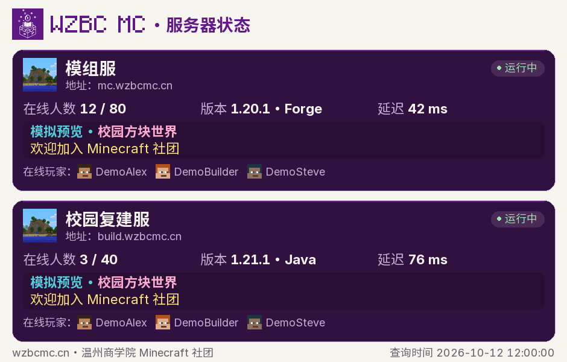
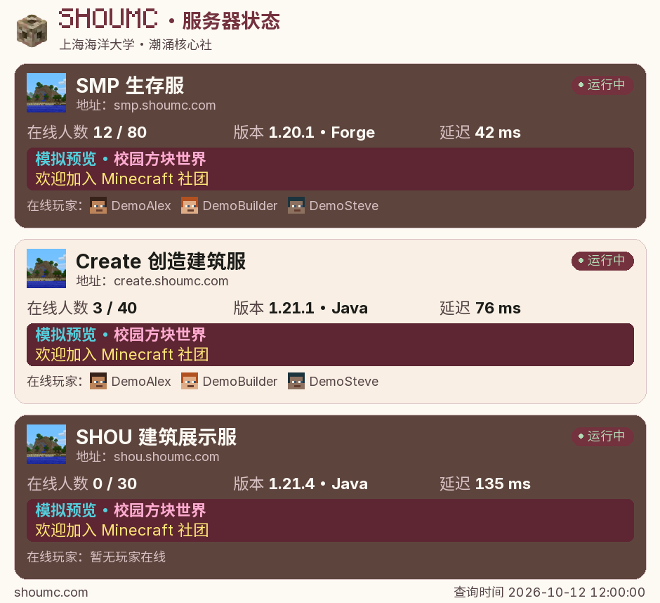

# Nekro MC Status

给 Nekro Agent 用的 Minecraft Java 服务器查询插件。发一句“服务器里有人吗”，或者用 `/wzbc`、`/shou`，就能收到一张状态图。

最初是给温商和水专的 MC 社群做的，所以保留了两套配色。服务器地址可以在后台换成自己的。插件直接运行在 Nekro 中，不需要安装 AstrBot。

项目由 **GPT 辅助制作**，由维护者整理、测试和发布。

## 预览

下面用模拟人数、版本、延迟和玩家演示排版，不代表当前服务器状态。

| 温商 | 水专 |
| --- | --- |
|  |  |

品牌栏、卡片间距和页脚都比较紧凑，方便在 QQ 群里看。卡片使用服务器返回的图标和 MOTD，玩家头像放在名字前面。MiniMOTD 输出的 JSON 文本、RGB 颜色和常用样式可以解析；资源包字体和动态混淆效果不支持。

## 使用

| 命令 | 默认查询 |
| --- | --- |
| `/wzbc` | `mc.wzbcmc.cn`、`build.wzbcmc.cn` |
| `/shou` | `smp.shoumc.com`、`create.shoumc.com`、`shou.shoumc.com` |

两个命令默认对所有人开放。也注册了 Nekro 原生命令，使用你在 Nekro 设置的前缀，例如 `!wzbc`。原生命令的最终权限仍受命令中心设置影响。

群里可以问“服务器里有人吗”“MC 服现在几个人”“查一下温商服务器状态”“水专服能进吗”。没提学校时按当前群绑定查；未绑定就提示选择命令，不猜学校，也不会因为使用命令自动改绑定。明确提到学校时以消息为准。引用、转发和历史故障讨论会保守跳过。

自然语言识别用固定规则，不调用大模型。若同时用了会返回 `FORCE_TRIGGER` 的回复判断插件，请按 [联动说明](docs/reply-judge.md) 加承接检查，避免查完又多回一条。

## 安装

适配 **Nekro Agent 2.4.0**，需要 **Python 3.11 或更新版本**。

1. 下载 [Release](https://github.com/Dr-jesper/nekro-mc-status/releases) 的 ZIP，或克隆仓库。
2. 把源码放进 Nekro 数据目录的 `plugins/workdir/nekro_mc_status/`，确保 `__init__.py` 就在该目录下，不要套两层。
3. 在运行 Nekro 的 Python 环境中安装 `requirements.txt`。缺失的依赖在插件加载时也会尝试通过 Nekro 的 `dynamic_import_pkg` 安装；离线环境请提前安装。
4. 在后台启用 `jesper.nekro_mc_status`，保存配置并重启 Nekro。
5. 在目标群用命令检查出图，再设置群绑定。

Docker 部署的解释器通常是 `/app/.venv/bin/python`，请以自己的部署为准，避免装到另一个 Python 环境。

## 配置

`GROUP_PROFILES` 的键是后台显示的完整 `chat_key`，不是单独的群号。以下全是示例：

```yaml
GROUP_PROFILES:
  onebot_v11-group_123456789: wzbc
  onebot_v11-group_987654321: shou
```

服务器清单 `WZBC_SERVERS`、`SHOU_SERVERS` 可以独立修改，每组最多 8 台：

```yaml
WZBC_SERVERS:
  - name: 生存服
    host: mc.example.org
  - name: 建筑服
    host: build.example.org:25565
```

| 配置项 | 默认值 | 用途 |
| --- | --- | --- |
| `ENABLED` / `NATURAL_LANGUAGE_ENABLED` | `true` | 总开关 / 群聊自然语言查询 |
| `ALLOW_GROUPS` / `DENY_GROUPS` | 空列表 | 限定频道；禁止列表优先，允许列表为空时不限 |
| `WZBC_STYLE` / `SHOU_STYLE` | `wzbcmc` / `shoumc` | 也可选 `rich`、`simple` |
| `SHOW_AVATARS` | `true` | 显示玩家头像 |
| `FONT_PATH` | 空字符串 | 自定义中文字体；默认用随包的 Sarasa UI SC |
| `DISPLAY_TIMEZONE` | `Asia/Shanghai` | 图中请求时间的时区 |
| `CACHE_SECONDS` | `10` | 状态缓存时长；页脚是本次请求时间 |
| `NATURAL_COOLDOWN_SECONDS` / `COMMAND_COOLDOWN_SECONDS` | `20` / `3` | 群问句 / 显式命令冷却秒数 |
| `QUERY_TIMEOUT_SECONDS` / `REQUEST_TIMEOUT_SECONDS` | `5` / `20` | 单服 / 查询、头像和出图的总时限 |
| `MAX_CONCURRENT_REQUESTS` | `2` | 同时处理的查询数 |
| `TEMP_RETENTION_SECONDS` | `600` | 插件私有成图保留时间；发送副本由 Nekro uploads 管理 |

## 有几个限制

- 玩家名单只显示服务器实际提供的 sample。没有名单会明确提示，不会用在线人数凑出名字。
- 头像优先按 UUID 向 Mojang 查询，失败用灰色问号占位。离线服和自定义皮肤插件不一定能提供可识别的官方皮肤。
- MiniMOTD 在服务端已渲染成状态协议文本；插件读取这个结果，不读取服务端配置。
- 超时显示“无法确认状态”，不当成 0 人。全部查询失败或出图失败时返回文本。
- Rich/Simple 是本插件的显示选项。AstrBot 上游的服务器管理、历史趋势等命令没有移植。

## 测试与出图

```sh
python -m venv .venv
# 激活环境后：
python -m pip install -r requirements-dev.txt
python -m pytest
python examples/render_demo.py --output demo-output
```

离线示例只用随仓库提供的模拟数据，不查询服务器或玩家。测试不需要 QQ 账号、API 密钥或运行中的 Nekro；命令层使用限定的 SDK 桩，不能代替真实平台收发测试。

## 来源与许可

代码使用 **AGPL-3.0**，全文见 [LICENSE](LICENSE)。查询和部分绘图逻辑源于 [Aer-Light-Work/astrbot_mcgetter_enhanced](https://github.com/Aer-Light-Work/astrbot_mcgetter_enhanced)，它又基于 [exynos967/astrbot_mcgetter_enhanced](https://github.com/exynos967/astrbot_mcgetter_enhanced)。感谢薄暝、Aer 和上游贡献者。

改动见 [CHANGELOG](CHANGELOG.md)。字体、社团标识和 Minecraft 素材保留各自归属与许可，详见 [NOTICE](NOTICE.md) 和 [资源说明](resources/README.md)。本项目与 Mojang/Microsoft 没有官方关联。
